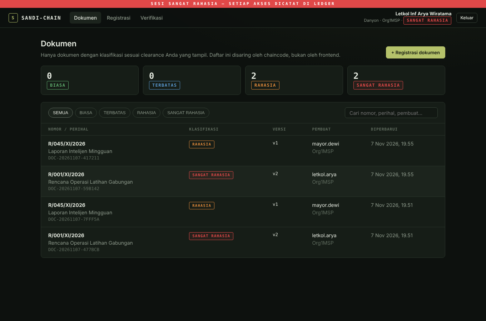
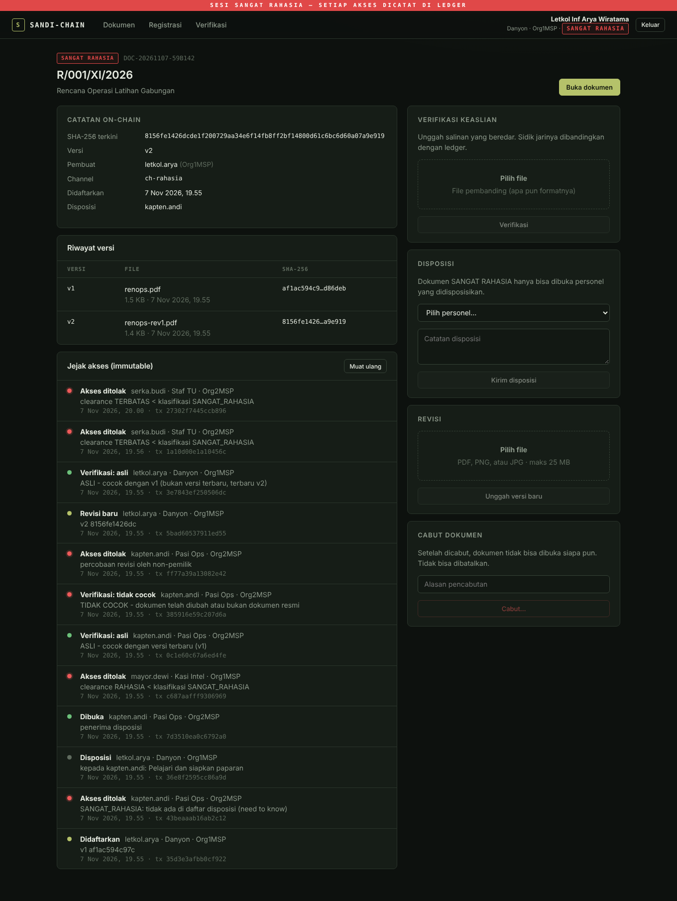
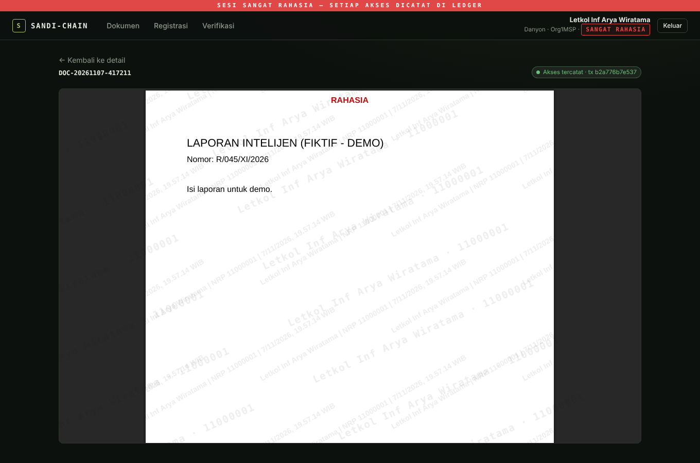
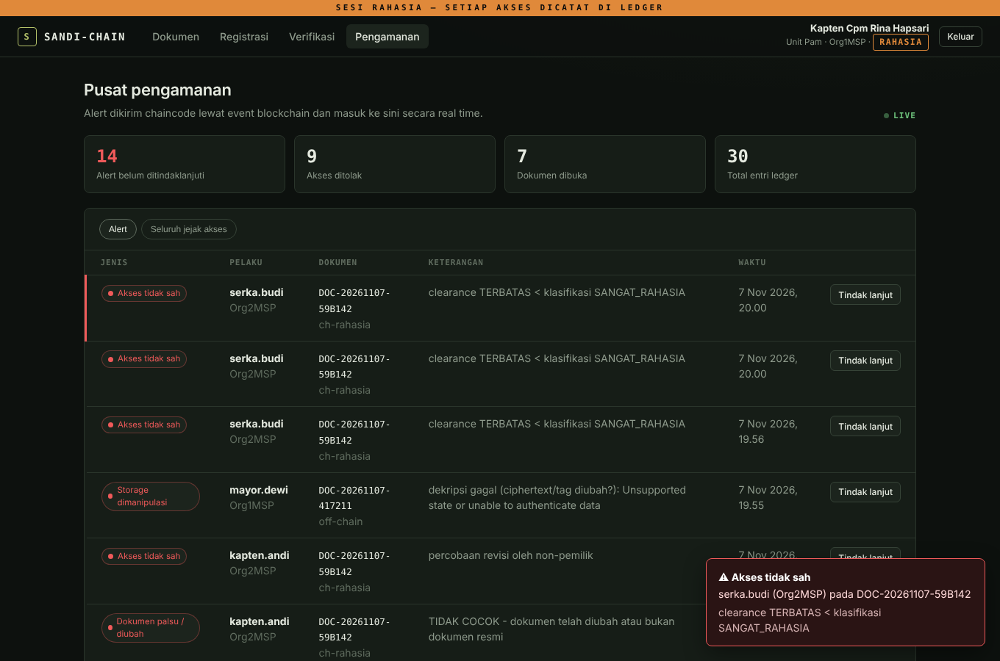

# SANDI-Chain

**Sistem Integritas & Jejak Akses Dokumen Rahasia Berbasis Permissioned Blockchain**

Prototype pengelolaan dokumen klasifikasi (BIASA, TERBATAS, RAHASIA, SANGAT RAHASIA) di atas Hyperledger Fabric. File tidak pernah masuk blockchain. File dienkripsi lalu disimpan di object storage, sedangkan ledger menyimpan **sidik jari SHA-256, versi, disposisi, dan setiap aksi** yang ditandatangani sertifikat X.509 milik personel.

> Semua nama personel dan dokumen di repo ini fiktif, untuk demo.

---

## Fitur

| Fitur | Cara kerja |
|---|---|
| **Kontrol akses berbasis atribut (ABAC)** | `clearance`, `jabatan`, `role` ditanam di sertifikat oleh Fabric CA. Chaincode yang memutuskan, bukan frontend/backend. |
| **Need-to-know** | Dokumen SANGAT RAHASIA hanya bisa dibuka (dan bahkan terlihat di daftar) oleh pemilik, penerima disposisi, dan auditor, meskipun clearance orang lain sama tinggi. Penerima diidentifikasi dengan MSP + CN, jadi CN yang sama di org lain tidak ikut mendapat akses. |
| **Jejak akses immutable** | Setiap buka, tolak, verifikasi, revisi, disposisi, cabut tercatat di ledger. Admin tidak bisa menghapusnya. |
| **Penolakan tetap tercatat** | Akses ilegal (buka, registrasi, revisi, disposisi, verifikasi tanpa wewenang) tidak dikembalikan sebagai error (yang akan membatalkan transaksi), tetapi di-commit sebagai `ACCESS_DENIED`. |
| **Konsistensi ledger ↔ DB** | Metadata disimpan `pending` sebelum transaksi Fabric. Sukses → `committed`; ditolak → dihapus beserta objeknya. Kalau status commit tidak pasti (timeout), rekonsiliasi berkala mencocokkan dengan ledger. |
| **Early warning real time** | Chaincode memancarkan event, *Sentinel* di backend meneruskannya ke dashboard (SSE), file JSON untuk Wazuh, dan webhook. |
| **Verifikasi keaslian** | Unggah salinan yang beredar → ASLI / cocok versi lama / TIDAK COCOK (perubahan 1 bit pun terdeteksi). |
| **Envelope encryption** | AES-256-GCM per dokumen, kunci dibungkus Vault Transit (kunci *derived* dengan konteks `channel/docId`). Admin storage/DB tidak bisa membaca isi. |
| **KeyGuard: tidak ada dekripsi tanpa jejak ledger** | Backend API tidak punya izin decrypt di Vault. Kunci dokumen hanya dilepas oleh layanan KeyGuard terpisah jika ledger memuat `ACCESS_GRANTED` yang baru (≤120 detik) dan belum pernah dipakai, untuk channel/dokumen yang sama. Backend yang dibobol pun tidak bisa membuka dokumen diam-diam. |
| **Tamper-evident terhadap admin storage** | Ciphertext yang diubah di storage ditolak saat dibuka dan memicu alert `StorageIntegrity`. |
| **Watermark dinamis yang menyatu dengan isi** | PDF yang ditampilkan berisi nama, NRP, waktu, dan txId akses di tiap halaman, sehingga foto layar bisa dilacak ke entri ledger. Untuk RAHASIA ke atas, tiap halaman dirender menjadi gambar setelah diberi watermark: watermark tidak bisa dibuang dengan menghapus objek di editor PDF dan teks tidak bisa disalin. |
| **Tanda tangan di perangkat personel** (`SIGNING_MODE=client`) | Kunci privat personel tidak ada di server. Backend menitipkan pesan Fabric ke perangkat; perangkat membaca isinya dan hanya menandatangani aksi yang benar-benar diminta user di perangkat itu (fungsi + argumen, termasuk hash file yang dihitung di perangkat). Backend yang dibobol tidak bisa memalsukan akses atas nama personel. |
| **Channel per klasifikasi** | `ch-umum` (BIASA, TERBATAS) dan `ch-rahasia` (RAHASIA, SANGAT RAHASIA). |
| **Multi-org consensus** | Org1 (Mabesad/Kodam) dan Org2 (Satuan) harus sama-sama meng-endorse transaksi. |

## Tampilan

| Daftar dokumen | Detail & jejak akses |
|---|---|
|  |  |
| **Viewer berwatermark** | **Pusat pengamanan (alert live)** |
|  |  |

## Arsitektur

```
 Browser ──► Next.js portal (:3000) ──/api proxy──► NestJS API (:4000)
                                                     │
          ┌───────────────┬──────────────┬───────────┼────────────────────┬──────────────────┐
          ▼               ▼              ▼           ▼                    ▼                  ▼
   Hyperledger Fabric   Vault Transit   S3 storage   PostgreSQL       Sentinel           KeyGuard (:4100)
   2 org + Raft + CA    (KEK, DEK wrap) (ciphertext) (metadata,       ├─► SSE dashboard   cek ACCESS_GRANTED
   chaincode Go           ▲ decrypt                   alert, ckpt,    ├─► alerts.log      di ledger ─► Vault
   ch-umum / ch-rahasia   └──────── hanya KeyGuard    login)          └─► webhook         decrypt
```

**Alur membuka dokumen**

1. Backend memanggil `RequestAccess` dengan identitas personel. Chaincode mengecek atribut sertifikat dan mencatat hasilnya.
2. Kalau ditolak → `ACCESS_DENIED` di ledger + event `UnauthorizedAccess` → alert ke unit pengamanan.
3. Kalau diizinkan → ambil versi yang hash-nya sama dengan ledger → backend mengirim txId akses ke KeyGuard → KeyGuard memastikan entri `ACCESS_GRANTED` itu ada di ledger, masih baru, dan belum dipakai → Vault meng-unwrap DEK (konteks `channel/docId`) → dekripsi.
4. SHA-256 hasil dekripsi dicocokkan lagi dengan ledger. Kalau beda → alert `StorageIntegrity`.
5. PDF dirender dengan watermark (nama, NRP, waktu, txId) dan dikirim `no-store`.

## Struktur

```
sandi-chain/
├── chaincode/sandichain/      Chaincode Go (fabric-contract-api-go v2)
│   └── contract/              contract.go, helpers.go (aturan akses), model.go, rules_test.go
├── backend/                   NestJS
│   ├── src/fabric/            Fabric Gateway, 1 gateway per personel
│   ├── src/signing/           Perantara tanda tangan untuk kunci di perangkat (SIGNING_MODE=client)
│   ├── src/keyguard/          KeyGuard: pelepasan kunci dokumen berbasis bukti akses di ledger
│   ├── src/crypto/            Envelope encryption (Vault Transit / local)
│   ├── src/watermark/         Watermark PDF/gambar (pdf-lib)
│   ├── src/alerts/            Sentinel: listener event + SSE + Wazuh + webhook
│   ├── src/documents/         Alur bisnis dokumen
│   ├── config/users.seed.json Personel demo (fiktif)
│   └── scripts/               enroll-users.mjs, demo.mjs
├── frontend/                  Next.js 16 (App Router)
│   └── src/lib/               sign-policy.ts (apa yang boleh ditandatangani), card*.ts (kunci perangkat), signer.ts
├── scripts/                   network-up.sh, network-down.sh, cc-upgrade.sh
├── infra/seaweedfs/           Konfigurasi kredensial S3
└── docker-compose.yml
```

## Menjalankan

Prasyarat: Docker, Node.js 22, Go 1.22+, `curl`, `jq` (dipakai script Fabric). Linux atau macOS (Windows lewat WSL2).

```bash
# 1. Infrastruktur off-chain (PostgreSQL, S3, Vault)
docker compose up -d

# 2. Jaringan Fabric + 2 channel + deploy chaincode (pertama kali ±5-10 menit, unduh image)
./scripts/network-up.sh

# 3. Backend
cd backend
npm install
cp .env.example .env
sed -i "s/^JWT_SECRET=.*/JWT_SECRET=$(openssl rand -hex 24)/" .env   # macOS: sed -i ''
npm run enroll          # register personel ke Fabric CA + buat wallet
npm run start:dev       # http://localhost:4000/api

# 3b. (disarankan) KeyGuard: pisahkan izin decrypt dari backend
../scripts/vault-setup.sh   # cetak token terbatas: isi backend/.env & backend/keyguard.env
npm run keyguard:dev        # terminal lain, http://127.0.0.1:4100/keyguard
# Tanpa langkah 3b (KEYGUARD_URL kosong), backend decrypt langsung dengan token root: hanya untuk dev.

# 3c. (disarankan) Tanda tangan di perangkat: kunci privat personel tidak disimpan server
#     set SIGNING_MODE=client di backend/.env, lalu:
npm run enroll              # menerbitkan kartu di backend/cards/<username>.card.json (PIN default 123456)
#     restart backend. Saat login pertama di sebuah browser, portal meminta file kartu + PIN.

# 4. Frontend (terminal lain)
cd frontend
npm install
npm run dev             # http://localhost:3000
```

Login dengan akun demo (password `sandi123`):

| Username | Jabatan | Clearance | Org | Role |
|---|---|---|---|---|
| `letkol.arya` | Danyon | SANGAT RAHASIA | Org1 | user |
| `mayor.dewi` | Kasi Intel | RAHASIA | Org1 | user |
| `kapten.andi` | Pasi Ops | SANGAT RAHASIA | Org2 | user |
| `serka.budi` | Staf TU | TERBATAS | Org2 | user |
| `auditor.pam` | Unit Pam | RAHASIA | Org1 | auditor |

**Mode tanda tangan di perangkat.** Dengan `SIGNING_MODE=client`, setelah login portal meminta *kartu identitas* (`backend/cards/<username>.card.json`) dan PIN `123456`. Kunci diimpor sekali per browser sebagai kunci WebCrypto yang tidak bisa diekspor; tombol **Lepas kartu** menghapusnya dari perangkat. Portal harus dibuka lewat `localhost` atau HTTPS (syarat WebCrypto).

## Demo otomatis (untuk presentasi)

Dengan backend berjalan:

```bash
cd backend && node scripts/demo.mjs
```

Skenario yang dijalankan (28 pengecekan):

1. Danyon mendaftarkan dokumen SANGAT RAHASIA, Kasi Intel mendaftarkan dokumen RAHASIA.
2. Staf TU tidak melihat keduanya di daftar dan ditolak saat membuka (tercatat + alert).
3. Pasi Ops (clearance SR) ditolak sebelum didisposisikan, lalu bisa membuka setelah disposisi. PDF-nya berwatermark.
4. Kasi Intel (RAHASIA) ditolak membuka dokumen SR.
5. Verifikasi: file asli → ASLI, file diubah 1 bit → TIDAK COCOK.
6. Non-pemilik mencoba merevisi → ditolak dan tercatat. Pemilik merevisi → v2, file v1 tetap terverifikasi sebagai versi lama.
7. Simulasi admin storage mengubah ciphertext → pembukaan ditolak + alert `StorageIntegrity`.
8. Auditor melihat seluruh alert dan jejak; Staf TU ditolak membuka dashboard audit.
9. Staf TU mencoba mendaftarkan dokumen RAHASIA dan memverifikasi salinan dokumen RAHASIA → ditolak dan tercatat.
10. Pasi Ops tidak melihat metadata dokumen SR sebelum disposisi, dan melihatnya sesudahnya.
11. Cookie lama tidak bisa dipakai setelah logout.

Tips demo live: buka `/security` sebagai `auditor.pam` di satu jendela, lalu di jendela lain (incognito) login `serka.budi` dan coba buka dokumen rahasia. Alert muncul seketika.

## API ringkas

| Method | Endpoint | Keterangan |
|---|---|---|
| POST | `/api/auth/login` | Login, cookie httpOnly. Terkunci 15 menit setelah 5 password salah |
| POST | `/api/auth/logout` | Mencabut sesi di server (token masuk daftar cabut sampai kedaluwarsa) |
| GET | `/api/documents` | Daftar dokumen (disaring chaincode sesuai clearance) |
| POST | `/api/documents` | Registrasi (multipart: `file`, `nomor`, `perihal`, `klasifikasi`) |
| GET | `/api/documents/:id/view` | Buka dokumen (PDF berwatermark), header `X-Access-Tx` |
| POST | `/api/documents/:id/verify` | Verifikasi keaslian (multipart `file`) |
| POST | `/api/documents/:id/versions` | Revisi (pemilik) |
| POST | `/api/documents/:id/disposition` | `{ recipient, catatan }` |
| POST | `/api/documents/:id/revoke` | `{ alasan }` |
| GET | `/api/documents/:id/audit` | Jejak akses (pemilik/auditor) |
| GET | `/api/documents/:id/history` | History key langsung dari ledger |
| GET | `/api/audit`, `/api/alerts` | Auditor |
| GET | `/api/alerts/stream` | SSE real time (auditor) |
| GET | `/api/sign/info` | Mode tanda tangan + sidik jari sertifikat user |
| GET | `/api/sign/next` | Long-poll: pesan Fabric berikutnya yang perlu ditandatangani perangkat |
| POST | `/api/sign/:id` | `{ signature }` (r‖s base64) atau `{ refuse }` |

## Fungsi chaincode

| Fungsi | Jenis | Catatan |
|---|---|---|
| `RegisterDocument(docId, nomor, hash, klasifikasi)` | submit | Clearance ≥ klasifikasi; penolakan tercatat |
| `AddVersion(docId, hash)` | submit | Pemilik; hash lama masuk `history` |
| `RequestAccess(docId)` | submit | Selalu mencatat; event `UnauthorizedAccess` saat ditolak |
| `VerifyDocument(docId, hash)` | submit | Hanya yang boleh melihat dokumen (`CanView`); event `DocumentTampered` saat tidak cocok |
| `AddDisposition(docId, recipient, recipientMsp, catatan)` | submit | Pemilik, dokumen belum dicabut |
| `RevokeDocument(docId, alasan)` | submit | Pemilik atau role admin |
| `GetDocument`, `ListDocuments` | evaluate | Disaring `CanView` (clearance + need-to-know SR; auditor melihat semua) |
| `ListDocumentsPage(pageSize, bookmark)`, `GetAllAuditLogsPage(pageSize, bookmark)` | evaluate | Versi berpaginasi (maks 500/halaman, bookmark kosong = habis); dipakai backend |
| `GetAuditTrail`, `GetAllAuditLogs`, `GetDocumentHistory` | evaluate | Pemilik / auditor / admin |
| `GetAccessGrant(docId, txId)` | evaluate | Role keyguard / auditor / admin; dipakai KeyGuard |

Aturan akses ada di fungsi murni `CanAccess` (membuka isi) dan `CanView` (melihat metadata/verifikasi) di `helpers.go`, diuji di `rules_test.go`.

## Pengujian

```bash
cd chaincode/sandichain && go test ./...     # aturan akses + transaksi di ledger tiruan (penolakan tercatat, need-to-know, paginasi)
cd backend && npm test                        # enkripsi + pengikatan konteks DEK, tamper GCM, watermark (termasuk raster), aturan KeyGuard,
                                              # tanda tangan di perangkat (kartu, kebijakan, broker, FabricService mode client)
cd backend && node scripts/demo.mjs           # end-to-end di jaringan Fabric asli
```

Upgrade chaincode tanpa menghapus ledger: `./scripts/cc-upgrade.sh 1.2 3` (versi, sequence naik 1 tiap upgrade). Signature `RegisterDocument` (kini mengembalikan `ActionResult`) dan `AddDisposition` (tambah `recipientMsp`) berubah, jadi upgrade chaincode dan backend harus bersamaan. Disposisi lama yang hanya berisi CN tetap berlaku dan dikunci ke MSP saat penerima yang sama didisposisikan ulang.

## Batasan prototype & jalan ke produksi

Prototype ini sengaja disederhanakan. Untuk penggunaan nyata:

| Prototype | Produksi |
|---|---|
| Mode default `SIGNING_MODE=server`: kunci privat personel di `wallet/` server. Backend yang dibobol bisa memalsukan `RequestAccess` atas nama personel (tetap tercatat di ledger berkat KeyGuard). | `SIGNING_MODE=client`: kunci di perangkat personel, perangkat memeriksa isi pesan sebelum menandatangani. |
| Mode client: kunci diterbitkan sebagai file kartu ber-PIN lalu disimpan browser (WebCrypto non-extractable). Script enroll sempat memegang kunci saat penerbitan. | Kunci dibangkitkan di dalam smartcard/token (PKCS#11/WebAuthn) dan tidak pernah berbentuk file; penerbitan oleh petugas registrasi, bukan server aplikasi. |
| Antrean permintaan tanda tangan disimpan di memori satu instance backend. | Sticky session atau antrean bersama (Redis) jika backend lebih dari satu instance. |
| Isi dokumen yang sah dibuka tetap melewati backend (didekripsi dan diberi watermark di sana). | Dekripsi di perangkat/enclave, atau backend di lingkungan tepercaya (HSM, confidential computing). |
| Backend ↔ KeyGuard diautentikasi shared secret | mTLS antar layanan, KeyGuard di host terpisah. |
| Login username/password + `users.json` | Keycloak/LDAP + mTLS smartcard. Clearance tetap dari sertifikat. |
| Vault dev mode (in-memory, token root) | Vault HA, auto-unseal dengan HSM, policy per service, audit device aktif. |
| `test-network` 2 org di satu mesin | Peer & orderer per Kodam/satuan, Raft ≥3 orderer (atau BFT di Fabric 3), CA terpisah, TLS mutual. |
| Perihal di PostgreSQL plaintext | Private Data Collection Fabric atau enkripsi kolom. |
| Watermark & viewer: halaman RAHASIA ke atas dikirim sebagai gambar ber-watermark. Ini menaikkan biaya, bukan jaminan: watermark abu-abu bisa dikurangi dengan pengolahan gambar, dan isi bisa diketik ulang atau difoto. | Ditambah DRM/viewer terkunci, pemblokiran print/download di endpoint, dan watermark forensik tak kasatmata. Watermark tidak mencegah pemotretan, tapi membuat pelaku bisa dilacak. |
| SeaweedFS dev | Object storage on-prem terenkripsi (MinIO/Ceph) di jaringan terisolasi. |

Semua komponen berjalan on-prem tanpa internet (font sistem, tanpa CDN), sesuai untuk jaringan air-gapped. Unduhan image dan dependency hanya diperlukan saat instalasi.

## Docker (opsional)

```bash
docker compose --profile app up -d --build   # backend + frontend dalam container
```

Prasyarat sama: jaringan Fabric jalan dan `npm run enroll` sudah dilakukan (wallet & users.json di-mount read-only).

## Reset total

```bash
./scripts/network-down.sh
docker compose down -v
```
